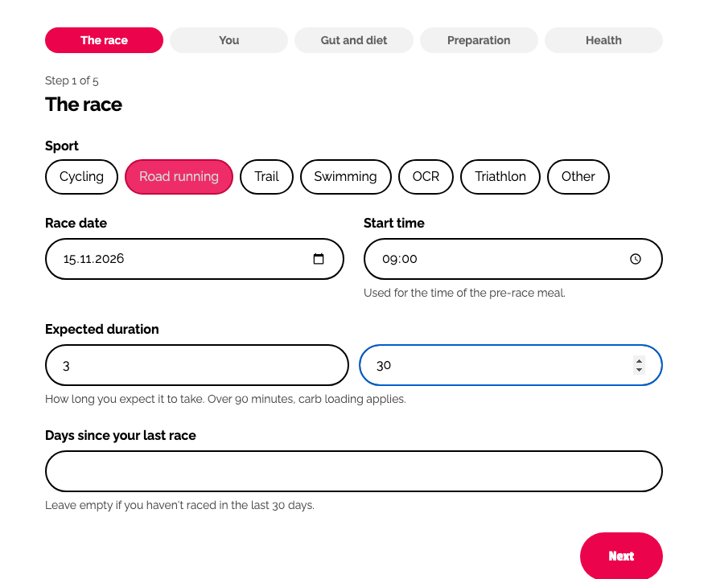
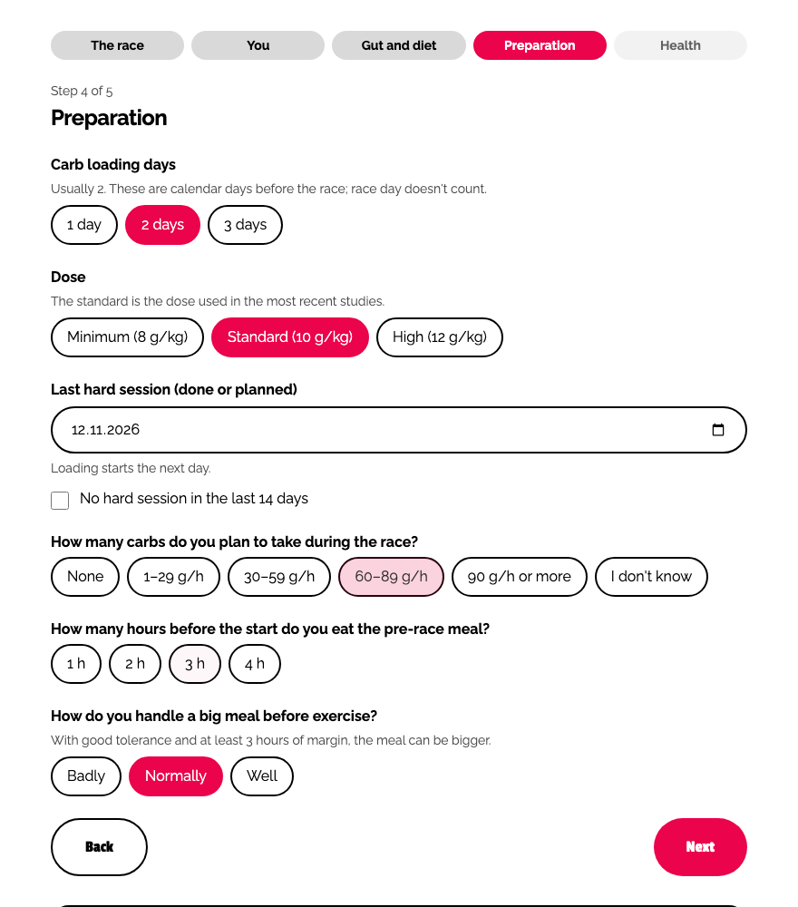
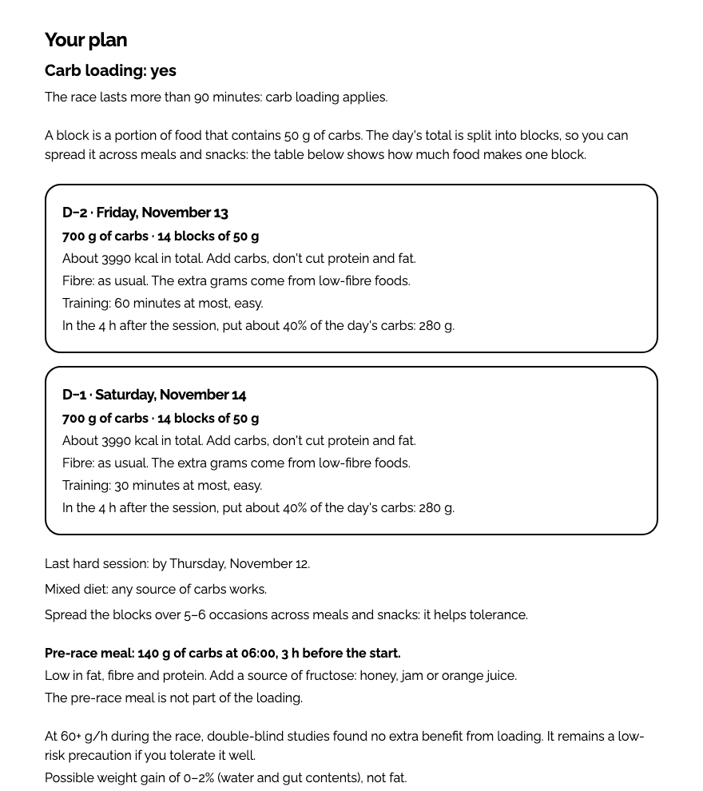
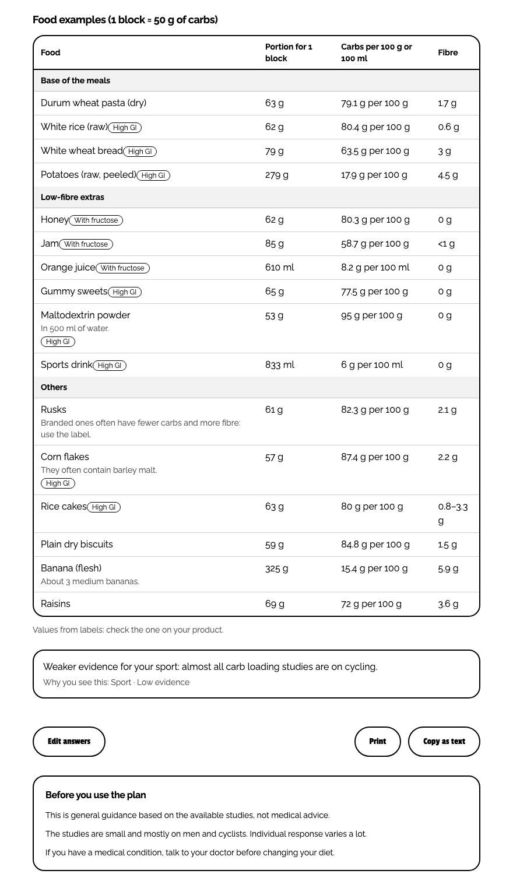

# Carb loading calculator

A free, open-source carb loading calculator by [typetwo](https://typetwo.eu). Tell it when your race is, how long it will take and a few things about you, and it builds a day-by-day plan with:

- **grams of carbs per day** in the 1 to 3 days before the race, split into 50 g "blocks"
- **food examples**: how much pasta, rice, bread, honey or sports drink makes one block
- the **pre-race meal**: how many grams, and at what time
- warnings for things that change or limit the plan (gut problems, a hard session too close to the race, a low-carb diet, and more)

It runs entirely in the browser. Nothing is sent anywhere or stored.

> **Not medical advice.** This is general guidance based on published sports-nutrition research. It does not replace a doctor or a registered sports dietitian. People with diabetes, who are pregnant, under 18 or with a history of eating disorders get no numbers at all. Anyone with a medical condition, or with irritable bowel syndrome, should talk to a professional before changing their diet.

## What you get

A short form (up to five steps) and the plan appears on the same page. These screenshots show a 3 h 30 min road race with a 09:00 start, a 70 kg athlete with no gut problems, two loading days at the standard dose and a pre-race meal 3 hours before the start.

<table>
  <tr>
    <td width="50%"></td>
    <td width="50%"></td>
  </tr>
  <tr>
    <td align="center">Step 1: the race</td>
    <td align="center">Step 4: the preparation</td>
  </tr>
</table>





### The parts of the plan

| Part | What it tells you |
| --- | --- |
| **Answer** | "Carb loading: yes", "Carb loading: no" (with the reason) or "No numeric plan" when the health answers block it. |
| **Loading days** | For each day (D−1 is the day before the race): grams of carbs, number of 50 g blocks, an estimate of the total kcal, fibre guidance, how long you can train (easy only) and how many grams to eat in the 4 hours after a session. |
| **Last hard session** | The latest date for a hard session so that loading can start the day after. |
| **Carb type** | Any source of carbs, or, with a single loading day, at least half of the blocks from high glycaemic index foods. |
| **Meals per day** | Spread the blocks over 5 to 6 occasions a day. |
| **Pre-race meal** | Grams of carbs (a single value or a range), the time to eat it, and that it is not part of the loading. |
| **What to expect** | Whether loading is likely to help, depending on how many carbs you will take during the race, and the possible weight gain (0 to 2%, water and gut contents). |
| **Food examples** | A table with the portion of each food that makes one block, its carbs per 100 g or 100 ml and its fibre. Foods are filtered for coeliac disease, lactose intolerance and a sensitive gut. |
| **Warnings** | The notes that apply to your answers, each with the question that raised it and how strong the evidence is. |
| **Before you use the plan** | The disclaimer, always shown. |

The result can be printed or copied as plain text.

## How it works

The calculator is a deterministic rule engine, not a model: the same answers (and the same "today") always give the same plan. It runs in these steps (`src/core/`).

1. **Validate.** The answers are checked against fixed ranges and every error is reported, not just the first. The race must be 1 to 365 days away. Questions that are not needed for the race duration, and the women-only health questions for male athletes, are dropped.
2. **Safety blocks.** No numbers are produced, and the plan is replaced by a message, if any of these is true: diabetes (any type), age under 18, pregnancy, or a history of eating disorders ("yes"). All blocks that apply are listed.
3. **Eligibility, by race duration.**
   - **Under 60 minutes**: no loading, eat as usual.
   - **60 to 90 minutes**: no loading, a **fuel-up** of 7 g of carbs per kg of body weight the day before the race.
   - **Over 90 minutes**: **carb loading**.
4. **Dose (loading only).** Carbs per day are 8 (minimum), 10 (standard, the default) or 12 (high) g per kg of body weight. The high dose is only available if you report no gut problems: otherwise the plan uses the standard dose and says so. Amounts are rounded to the nearest 10 g. One **block** is 50 g of carbs; the number of blocks is the day's carbs divided by 50, rounded.
5. **Calendar (loading only).** You ask for 1, 2 or 3 days (default 2). Loading starts the day after your last hard session, so the plan uses the smallest of: the days you asked for, the days between the session and the race minus one (never fewer than 1), and the days left before the race. A session on the day before the race gives one day and a warning. Training on loading days is easy and capped at 60 minutes, or 30 minutes on the day before the race. After a session, about 40% of the day's carbs go into the following 4 hours. The kcal figure is a fixed estimate: 4 kcal per g of carbs, plus 2 g of protein and 1 g of fat per kg of body weight. Fibre stays as usual, or drops under 10 g a day if your gut problems are frequent. With a single loading day, at least half of the blocks (rounded up) come from high glycaemic index foods.
6. **Pre-race meal (races of 60 minutes or more).** 1 g/kg if you eat it 1 hour before the start, 2 g/kg if 2 to 4 hours before. If you handle big meals well and eat 3 or 4 hours before, the meal can go up to 3 or 4 g/kg (shown as a range). The time is the start time minus the hours, and the plan says when it falls on the previous day. Amounts are rounded to the nearest 10 g. If the race starts at 12:00 or later, it suggests eating your usual carb-rich meals before the pre-race meal.
7. **What to expect (loading only).** Depends on the carbs you plan to take during the race: none or under 30 g/h, starting glycogen matters more, the scenario where loading showed the biggest benefits; 30 to 59 g/h or "I don't know", a plausible benefit, but the most rigorous studies are few; 60 g/h or more, no extra benefit found in double-blind studies. This text does not change the dose.
8. **Foods and warnings.** Portions are 50 g divided by the carb content of the food. Warnings are added from a registry (below), sorted in a fixed order.

Every number is in `src/core/data/thresholds.ts` with its source and how well it is supported (`high`, `medium`, `low` or `heuristic`, a rule of thumb or a product decision).

### Foods

The table has 16 foods, in three groups: base of the meals (pasta, rice, bread, potatoes), low-fibre extras (honey, jam, orange juice, gummy sweets, maltodextrin, sports drink) and others (rusks, corn flakes, rice cakes, dry biscuits, banana, raisins). Nutrient values come from the Italian food composition tables (INRAN, now CREA) or from product labels.

- **Coeliac disease** removes pasta, bread, rusks, dry biscuits and corn flakes (which often contain barley malt). Rice cakes stay, marked "check the label".
- **Lactose intolerance** removes no food from the table, but marks dry biscuits "check the label".
- **Frequent gut problems** remove banana and raisins.

### Warnings and blocks

| Code | When | Severity |
| --- | --- | --- |
| Diabetes, under 18, pregnancy, eating disorder history | The safety blocks above. | block |
| High dose unavailable | You asked for the high dose with occasional or frequent gut problems. | info |
| Session too close | Your last hard session is the day before the race (loading is cut to 1 day). | warning |
| Days reduced | Fewer loading days than requested because of the session date, or because too few days are left before the race. | info |
| IBS | Diagnosed irritable bowel syndrome (the plan is still given). | warning |
| Weak evidence for your sport | Loading, any sport but cycling. | info |
| Back-to-back races | Previous race 2 days ago or less, or exactly 3 days ago. | warning / info |
| Very long race | Over 240 minutes (loading). | info |
| Low-carb or ketogenic diet | Usual diet is low carb or keto. | warning |
| Food filters | Coeliac disease, lactose intolerance or frequent gut problems (races of 60 minutes or more). | info |
| Limited data for your age | Age 38 or more. | info |
| Eating disorder support | "Prefer not to say" to the eating disorder question. | info |
| RED-S or low energy | A RED-S diagnosis, or no periods for 3 months or more without hormonal contraception. | warning |

### What it does not take into account

It does not know your actual diet, your training load, your glycogen stores or your energy needs (the kcal figure is a fixed estimate). Your sex does not change the dose: it is only used to decide which health questions to ask. The sport does not change the numbers either, it only adds a warning outside cycling. It does not build a low FODMAP diet, and it does not plan what to eat **during** the race (see the carbs per hour calculator below). Treat the plan as a starting point and try the loading once before a long training session.

### What the calculator takes into account

#### The race

| Input | Required | How it is used |
| --- | --- | --- |
| Sport | yes | Cycling, road running, trail, swimming, OCR, triathlon or other. Only adds a warning when it is not cycling. |
| Race date | yes | 1 to 365 days from today. Sets the dates of the loading days. |
| Start time | yes | Gives the time of the pre-race meal. |
| Expected duration | yes | 10 minutes to 48 hours. Decides no plan, fuel-up or loading, and whether the pre-race meal applies. |
| Days since your last race | no | 0 to 30. Warns about back-to-back races. |

#### The athlete, gut and diet

| Input | Required | How it is used |
| --- | --- | --- |
| Body weight | yes | 35 to 150 kg. All doses are in g per kg. |
| Age | yes | 10 to 100. Under 18 is blocked, 38 or more gets a note. |
| Sex | yes | Only decides whether the pregnancy and periods questions are asked. |
| Gut problems | yes | None, occasional or frequent. Occasional or frequent turns off the high dose. Frequent also lowers fibre and removes some foods. |
| Diagnosed IBS | yes | Adds a warning. |
| Coeliac disease, lactose intolerance | yes | Filter the foods. |
| Usual diet | no | Mixed (default) or low carb/keto, which adds a warning. |

#### The preparation (races over 60 minutes, loading questions over 90)

| Input | Required | How it is used |
| --- | --- | --- |
| Carb loading days | no | 1, 2 (default) or 3. May be reduced. |
| Dose | no | Minimum, standard (default) or high. |
| Last hard session | yes (loading) | A date within 14 days before the race, or "no hard session". Loading starts the next day. |
| Carbs planned during the race | yes (loading) | Only changes the "what to expect" text. |
| Hours before the start of the pre-race meal | yes | 1 to 4. |
| Big meal tolerance | no | Badly, normally (default) or well. Only "well", with 3 or 4 hours of margin, raises the pre-race meal. |

#### Health

| Input | Effect |
| --- | --- |
| Diabetes (type 1, type 2, other) | The plan is blocked. |
| Pregnant (not asked to male athletes) | The plan is blocked. |
| Eating disorder history | "Yes" blocks the plan. "Prefer not to say" adds a note. |
| RED-S or low energy availability diagnosis | Adds a warning. |
| No periods for 3 months or more (not asked to male athletes) | Adds the same warning. |

## Run it

```bash
npm install
npm run dev
```

Build a static site into `dist/` (it works from any path, for example GitHub Pages):

```bash
npm run build
```

## How it is organised

```text
src/core/       the calculation engine: pure TypeScript, no React, fully tested
src/core/data/  every threshold, the warning registry and the food table
src/ui/         the step-by-step form and the result page (React + Tailwind)
src/messages/   all user-facing text (English)
```

You can use `src/core/` on its own:

```ts
import { buildCarbLoadingPlan, parseCarbLoadingInput } from "./src/core";

const parsed = parseCarbLoadingInput(
  {
    raceDate: "2026-11-15",
    startTime: "09:00",
    weightKg: 70,
    age: 30,
    sex: "male",
    sport: "road_running",
    durationMin: 210,
    giHistory: "none",
    ibsDiagnosed: false,
    coeliac: false,
    lactoseIntolerance: false,
    lastHardSession: { kind: "none_recent" },
    raceCarbs: "dont_know",
    preMealHours: 2,
    diabetes: "no",
    pregnant: false,
    eatingDisorderHistory: "no",
    redsOrLowEnergyDiagnosis: false,
    amenorrhea3Months: false,
  },
  "2026-11-01", // today, as YYYY-MM-DD
);
if (parsed.ok) {
  const plan = buildCarbLoadingPlan(parsed.input); // same input, same plan
}
```

The engine returns codes and numbers, never sentences: the texts live in `src/messages/en.json`.

## Where the numbers come from

The plan follows published sports-nutrition research. The exact numbers are our own rules of thumb built on it, so test everything in training. In the code, each value names its source by author and year.

- **Carb loading dose, days and training**: Jones et al. 2026a (systematic review and meta-analysis), *Scand J Med Sci Sports* 36:e70379, doi:10.1111/sms.70379. Jones et al. 2026b (dose–response), *Scand J Med Sci Sports* 36:e70312, doi:10.1111/sms.70312. Solem et al. 2025, *Front Physiol* 16:1620943, doi:10.3389/fphys.2025.1620943.
- **Position stands and guidelines (durations, fuel-up, pre-race meal)**: Thomas, Erdman & Burke 2016, *J Acad Nutr Diet* 116:501–528, doi:10.1016/j.jand.2015.12.006. Burke et al. 2011, *J Sports Sci* 29(S1):S17–S27, doi:10.1080/02640414.2011.585473.
- **Short loading protocols**: Bussau et al. 2002, *Eur J Appl Physiol* 87:290–295, doi:10.1007/s00421-002-0621-5. Fairchild et al. 2002, *Med Sci Sports Exerc* 34:980–986, doi:10.1097/00005768-200206000-00012.
- **Does it improve performance?** Burke et al. 2000, *J Appl Physiol* 88:1284–1290, doi:10.1152/jappl.2000.88.4.1284. Jones et al. 2026c (absence of double-blinding), *Int J Sport Nutr Exerc Metab* 36(5):553–562, doi:10.1123/ijsnem.2026-0058.
- **Type and frequency of carbs**: Burke et al. 1993, *J Appl Physiol* 75:1019–1023, doi:10.1152/jappl.1993.75.2.1019. Burke et al. 1996, *Am J Clin Nutr* 64:115–119, doi:10.1093/ajcn/64.1.115.
- **Fibre, body weight and the gut**: Foo et al. 2022, *Int J Sport Nutr Exerc Metab* 32:256–264, doi:10.1123/ijsnem.2021-0324. Shiose et al. 2016, *J Appl Physiol* 121:205–211, doi:10.1152/japplphysiol.00126.2016. Lis et al. 2018, *Med Sci Sports Exerc* 50:116–123, doi:10.1249/MSS.0000000000001419.
- **Repeated loading**: McInerney et al. 2005, *Med Sci Sports Exerc* 37:404–411, doi:10.1249/01.MSS.0000155699.51360.2F. Doering et al. 2019, *J Sci Med Sport* 22:907–911, doi:10.1016/j.jsams.2019.03.009.
- **Low-carb diets**: Burke et al. 2021, *J Physiol* 599:771–790, doi:10.1113/JP280221.
- **Safety**: Riddell et al. 2017, *Lancet Diabetes Endocrinol* 5:377–390, doi:10.1016/S2213-8587(17)30014-1, and Riddell et al. 2020, *Diabetologia* 63:1475–1490, doi:10.1007/s00125-020-05183-8 (diabetes, cited as the reason for the block). Mountjoy et al. 2023, *Br J Sports Med* 57:1073–1097, doi:10.1136/bjsports-2023-106994 (RED-S).
- **Thesis**: Jones 2025, *Optimisation of carbohydrate intake for skeletal muscle glycogen synthesis and endurance cycling performance*, PhD thesis, Liverpool John Moores University.
- **Foods**: CREA (formerly INRAN), Italian food composition tables, and product labels.

## Also open source

- Carbs per hour calculator: carbs, fluids, sodium and caffeine during the race (`carbs-per-hour-calculator`).

## Contributing

See [CONTRIBUTING.md](CONTRIBUTING.md).

## License

[MIT](LICENSE). The typetwo name and logo are trademarks of typetwo and are not covered by the license.
